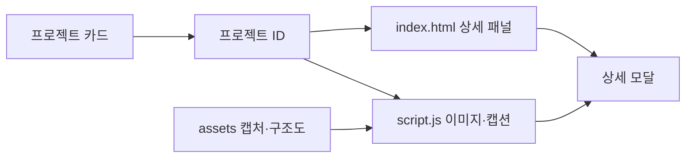

# Jung Yurim Portfolio — 프로젝트와 구현 근거를 연결하는 포트폴리오

> 정유림의 경험·기술·프로젝트를 한 페이지에서 확인하는 개인 포트폴리오입니다.
> 프로젝트별 실제 화면, 담당 역할, 기술적 의사결정과 검증 범위를 함께 담았습니다.


## 왜 만들었나

기존 PDF 포트폴리오의 정보를 웹에서 더 쉽게 탐색할 수 있도록 재구성했습니다. 요약만 읽거나 프로젝트 상세를 열어 실제 화면과 구현 근거를 확인할 수 있게 만들었습니다.

1. 소개와 기술 경험을 빠르게 살펴봅니다.
2. 관심 있는 프로젝트를 열어 화면·역할·문제 해결 과정을 확인합니다.
3. 공개 코드와 검증 자료로 연결해 설명의 근거를 확인합니다.

| 구분          | 내용                                             |
| ------------- | ------------------------------------------------ |
| 서비스 유형   | 개인 포트폴리오 정적 웹사이트                    |
| 아키텍처      | HTML·CSS·JavaScript, 별도 API 서버 없음          |
| 주요 구성     | About Me, Skills, Archiving, Projects, Awards    |
| 프로젝트 탐색 | 카드 목록, 상세 모달, 이미지·다이어그램 슬라이드 |
| 배포 방식     | GitHub Pages에서 제공 가능한 정적 파일 구조      |

## 기술 스택

| 구분        | 기술·방식                                      |
| ----------- | ---------------------------------------------- |
| 마크업      | HTML                                           |
| 스타일      | `styles.css`, `editorial.css`, 반응형 레이아웃 |
| 인터랙션    | JavaScript, DOM 이벤트                         |
| 스크롤 표현 | IntersectionObserver, 부드러운 스크롤          |
| 접근성      | 모달 초점 관리, 키보드 조작, 배경 inert 처리   |
| 테스트      | Node.js 내장 test runner, `node --test`        |
| 호스팅      | GitHub Pages                                   |

## A. 문서 범위

이 문서는 포트폴리오 웹사이트의 구성과 실행 방법을 설명합니다. 소개된 팀 프로젝트의 서버·AI·인프라 전체를 이 사이트가 구현한 것으로 보지 않습니다. 각 프로젝트의 개인 기여와 팀 성과, 현재 구현과 과거 개선 사례를 구분합니다.

## B. 목표 서비스 및 구현 정도

### 목표 사용자 흐름

```text
소개 → 기술 경험 → 프로젝트 목록 → 상세 모달
    → 화면·구조도·검증 사례 확인 → 공개 코드 탐색
    → 모달 닫기·다른 프로젝트 탐색
```

### 구현 상태

| 영역                                  | 상태                                                         |
| ------------------------------------- | ------------------------------------------------------------ |
| 소개·기술·프로젝트·수상 섹션          | 구현                                                         |
| 프로젝트 상세 모달·슬라이드           | 구현                                                         |
| 스크롤 등장 효과·상단 이동            | 구현                                                         |
| 모달 Escape·좌우 화살표·Tab 초점 순환 | 구현                                                         |
| 반응형 UI                             | CSS 구성 포함                                                |
| 자동 검사                             | `npm test` 스크립트 포함                                     |
| 배포                                  | GitHub Pages 설정 후 서비스 가능; 현재 접속 상태는 별도 확인 |

## C. 콘텐츠 및 화면 구조

콘텐츠는 `index.html`의 섹션과 상세 패널에 있고, 프로젝트별 이미지·캡션은 `script.js`의 `projectSlides`가 관리합니다. 별도 데이터베이스는 사용하지 않습니다.



### 콘텐츠 관리 기준

- 실제 서비스 캡처, 인형 데모, 구조도, 구현 예정 흐름도를 구분합니다.
- 개인 담당 화면과 팀 서버 구조·성능 수치를 구분합니다.
- 성능 수치는 맵·인원·틱·미디어 사용 여부 등 측정 조건을 함께 적습니다.
- 진행 중 프로젝트는 완료한 분석과 예정 개발을 나누어 설명합니다.

## D. 인터랙션 처리 흐름

1. 카드의 `data-project`로 선택한 프로젝트를 찾습니다.
2. 해당 상세 패널을 활성화하고 첫 슬라이드를 표시합니다.
3. 배경 스크롤과 조작을 제한하고 닫기 버튼으로 초점을 옮깁니다.
4. 좌우 버튼·화살표로 슬라이드를 순환합니다.
5. Escape·닫기 버튼·배경 클릭으로 닫고 원래 초점을 복원합니다.

`IntersectionObserver`는 섹션의 등장 효과를 처리하고, 스크롤 위치에 따라 상단 이동 버튼을 표시합니다.

## E. 핵심 기능

### 1. 소개와 경험 요약

개발자로 전환한 배경, 기술 경험, 아카이빙 링크, 수상 이력을 제공합니다.

### 2. 프로젝트 상세 탐색

| 프로젝트          | 소개 초점                                                            |
| ----------------- | -------------------------------------------------------------------- |
| 잇담              | 주요 화면 구현, 문장 저장 상태 개선, 현재 수동 저장과 초기 사례 구분 |
| 까꿍              | 게임 HUD·장비·장치 점검 UI, 팀의 StateView 구조와 제한된 측정 조건   |
| GotYA             | 콘텐츠 공통 모델, 데이터 모델링·API·추천 흐름                        |
| HomeKeeper        | 외부 주거 데이터 수집·정제·시범 분석과 지도, 분석의 한계             |
| 에이엑스코어 연계 | 2026.10.19 기준 요구사항 분석·설계 및 예정 개발 범위                 |
| 개인 포트폴리오   | 목록·모달·UI 개선 과정                                               |

### 3. 키보드와 초점 관리

모달에서 Tab 초점을 순환하고 Escape로 닫을 수 있습니다. 모달을 닫으면 이전에 선택한 카드로 초점을 돌려 탐색 흐름을 유지합니다.

## F. 생성형 AI 활용

### 사이트 자체의 AI 기능

이 사이트의 현재 클라이언트 구조에는 생성형 AI 호출 기능이 없습니다. 프로젝트 소개에 등장하는 AI 평가·추천·분석은 각 프로젝트의 기능과 계획입니다.

### 개발 과정에서의 AI

개발 보조 도구 사용 이력은 확인된 별도 기록 없이 단정하지 않습니다. 이미지나 흐름도가 실제 서비스 화면인지, 설명용 자료인지 구분하는 기준을 유지합니다.

## G. 실행 방법

### 로컬 실행

정적 사이트이므로 별도 빌드 없이 저장소 루트의 `index.html`을 브라우저에서 열 수 있습니다. 로컬 HTTP 서버를 사용하려면 다음과 같이 실행합니다.

```bash
npx serve .
```

서버가 출력한 로컬 주소로 접속합니다. 개발 서버의 포트는 실행 결과를 기준으로 확인합니다.

### 테스트

Node.js가 설치된 환경에서 실행합니다.

```bash
npm test
```

`package.json`의 테스트 명령은 `node --test`이며, 별도 개발 의존성은 등록되어 있지 않습니다. 정적 검사를 통과하는 것과 실제 브라우저의 모바일·키보드 동작 확인은 별개입니다.

### GitHub Pages 배포

1. 저장소의 `Settings > Pages`로 이동합니다.
2. 배포 소스를 `Deploy from a branch`로 선택합니다.
3. 브랜치 `main`, 폴더 `/(root)`를 지정합니다.
4. 배포 완료 후 [포트폴리오 주소](https://JJ-Yurim.github.io/Portfolio/)를 확인합니다.

위 주소는 배포 대상 주소이며 이 README의 작성만으로 배포 완료를 의미하지 않습니다.

## H. 기타 기록

### 파일 구조

```text
.
├─ index.html       # 소개·프로젝트 목록·상세 패널
├─ styles.css       # 기본 스타일
├─ editorial.css    # 추가 화면 스타일
├─ script.js        # 모달·슬라이드·스크롤·초점 관리
├─ assets/
│  ├─ captures/     # 실제 화면과 검수 캡처
│  └─ diagrams/     # 구조도·설명용 흐름도
├─ tests/
├─ package.json
└─ .nojekyll
```

### 트러블슈팅과 문서 유지 기준

| 확인할 점                          | 유지 방식                                   |
| ---------------------------------- | ------------------------------------------- |
| 소개 수치가 개인 성과로 오해됨     | 팀 측정과 개인 기여를 분리                  |
| 과거 개선 사례가 현재 동작과 다름  | 잇담 초기 자동 저장과 현재 수동 저장을 명시 |
| 설계 흐름도가 서비스 캡처로 오해됨 | 진행 중·구현 예정 표기                      |
| 모달을 닫은 뒤 탐색 위치를 잃음    | 이전 초점 복원                              |

### 개선 방향

- 이미지 용량과 모바일 화면의 가독성을 지속적으로 점검합니다.
- 프로젝트가 바뀌면 HTML 설명, `projectSlides`, 이미지 캡션, 검증 근거를 함께 갱신합니다.
- 배포 후 실제 브라우저에서 링크·모달·키보드·화면 크기별 동작을 확인합니다.
